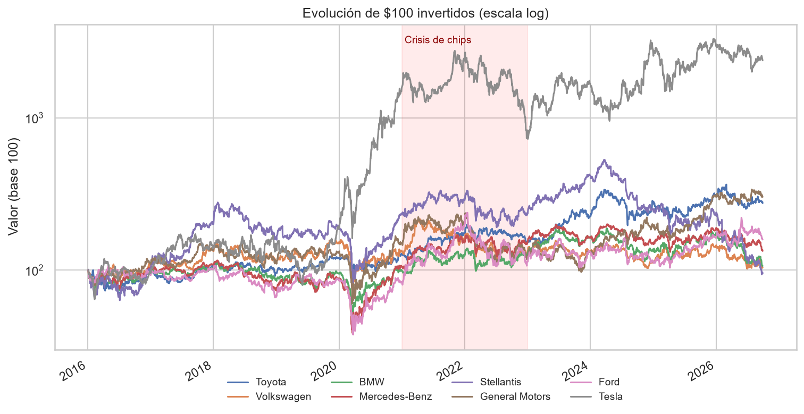
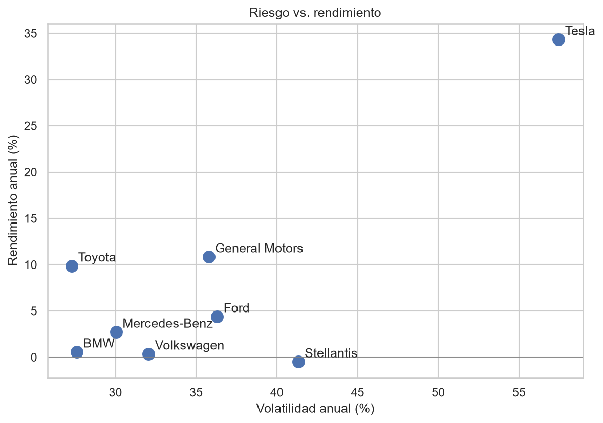
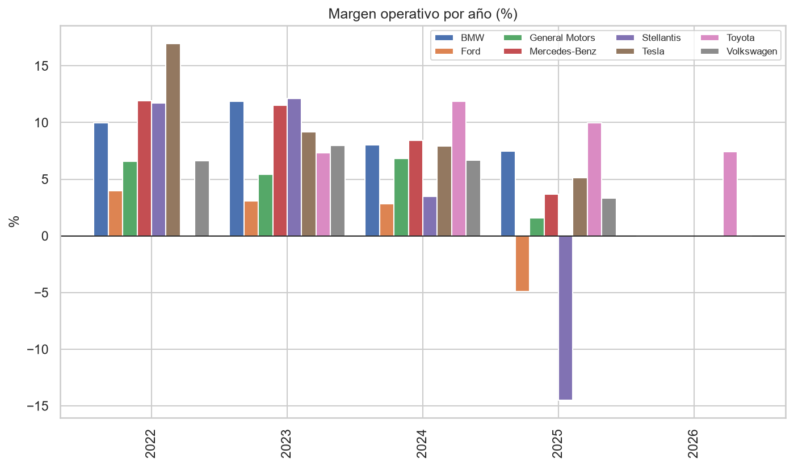

# Análisis del sector automotriz (2016–2026)

¿Qué armadoras han creado más valor en la última década y cuáles resistieron mejor la crisis de semiconductores?

Este proyecto compara el desempeño bursátil y financiero de **Toyota, Volkswagen, BMW, Mercedes-Benz, Stellantis, General Motors, Ford y Tesla** usando Python.

## Preguntas que responde

1. ¿Cuánto valdrían hoy $100 invertidos en cada empresa?
2. ¿Quién ofrece mejor rendimiento por unidad de riesgo?
3. ¿Qué tanto golpeó la crisis de chips (2021–2022) a cada una y cuánto tardaron en recuperarse?
4. ¿Las armadoras alemanas se mueven igual que las estadounidenses?
5. ¿Invertir más en I+D se traduce en mejores márgenes?

## Resultados







### Hallazgos principales

- _Hallazgo 1_
- _Hallazgo 2_
- _Hallazgo 3_

## Metodología

- **Datos:** precios diarios ajustados y estados de resultados anuales de Yahoo Finance vía [`yfinance`](https://github.com/ranaroussi/yfinance).
- **Comparabilidad:** las empresas cotizan en JPY, EUR y USD, así que se comparan **rendimientos normalizados (base 100)** y **márgenes en %**, no valores absolutos.
- **Métricas:** rendimiento anualizado (CAGR), volatilidad anualizada, máxima caída (drawdown), días de recuperación y correlación de rendimientos diarios.

## Estructura

```
├── data/
│   ├── raw/              # datos descargados
│   └── processed/        # datos limpios
├── notebooks/
│   └── analisis.ipynb    # análisis completo con gráficas
├── src/
│   ├── config.py         # empresas, fechas y rutas
│   ├── descarga_datos.py # descarga de Yahoo Finance
│   └── analisis.py       # funciones de análisis y gráficas
├── images/               # gráficas exportadas
└── requirements.txt
```

## Cómo correrlo

```bash
git clone https://github.com/TU_USUARIO/analisis-automotriz.git
cd analisis-automotriz
pip install -r requirements.txt
python src/descarga_datos.py
jupyter notebook notebooks/analisis.ipynb
```

## Limitaciones

- `yfinance` solo entrega ~4 años de estados financieros.
- Stellantis existe desde 2021 (fusión FCA + PSA), así que su serie es más corta.
- No todas las empresas reportan I+D como partida separada.

## Autor

**Emilio Turribiates González** — Ingeniería Mecatrónica, Universidad Anáhuac
[LinkedIn](https://linkedin.com/in/TU_PERFIL) · [GitHub](https://github.com/TU_USUARIO)
